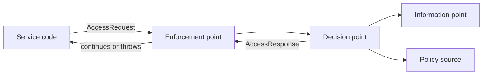

# Key concepts

Attribute based access control decides a request by looking at its attributes, not at who is asking or which URL they
called. A role check is one such policy. So is "the author of an article may delete it", "deletions are refused
outside business hours" or "a user may see a document when one of its collaborators is them". All of them are
expressed the same way, and all of them live together, away from your routing.

## The access request

A request has four parts, each a map of attributes:

| Part | What it describes | Typical attributes |
|------|-------------------|--------------------|
| Subject | Who is asking, usually a user | `id`, `roles`, `type` |
| Action | What they are trying to do | `type`: `READ`, `DELETE`, ... |
| Resource | What they are trying to do it to | `type`, `id`, `authorId` |
| Environment | The circumstances | `hour`, `ip`, `stage` |

Every part is optional and may hold only the attributes a check needs. Attributes can nest, and a value can be a
collection.

## Policies

A policy is a function from an access request to granted or denied. Warden's DSL builds policies from expressions over
attributes, such as `subject("roles") contains "Author"`, combined with `allOf`, `anyOf` and `not`. Any class that
implements `Policy` is a policy too.

## Decision point

A decision point evaluates a request against two sets of policies and returns an `AccessResponse`:

1. If no allow policy grants access, access is denied.
2. If an allow policy grants access and a deny policy also grants, access is denied.
3. If an allow policy grants access and no deny policy does, access is granted.

Nothing is allowed by default. Deny policies are for rules that must hold whatever else is true.

## Policy source

The decision point gets its policies from a policy source. The simplest holds two lists in memory. A source can also
load policies from a database, or return only the policies that apply to the request it is given.

## Information point

Requests often arrive with less than the policies need. A subject may carry only an ID when a policy asks about roles.
An information point enriches a request before evaluation, by fetching the missing attributes from wherever they
live. The decision point applies it to every request.

## Enforcement point

An enforcement point guards an execution path. It asks the decision point and throws `NotAuthorizedException` when
access is denied, so the code after it only runs for granted requests. It can also filter a list of resources down to
those the request is granted for.

## Why attributes are maps

The request and the policies are deliberately not typed against your domain classes.

- A check rarely needs a whole entity. A few attributes are enough, and cheaper to assemble.
- The attributes of one part can come from several sources: a token, a database row, a header.
- A policy may not care what type a subject or resource is, only that two IDs match.
- Keeping the evaluation boundary free of generics and reflection keeps it small and easy to reason about.

Conversion of your classes to attribute maps is a layer above the core, which is what  provides.
